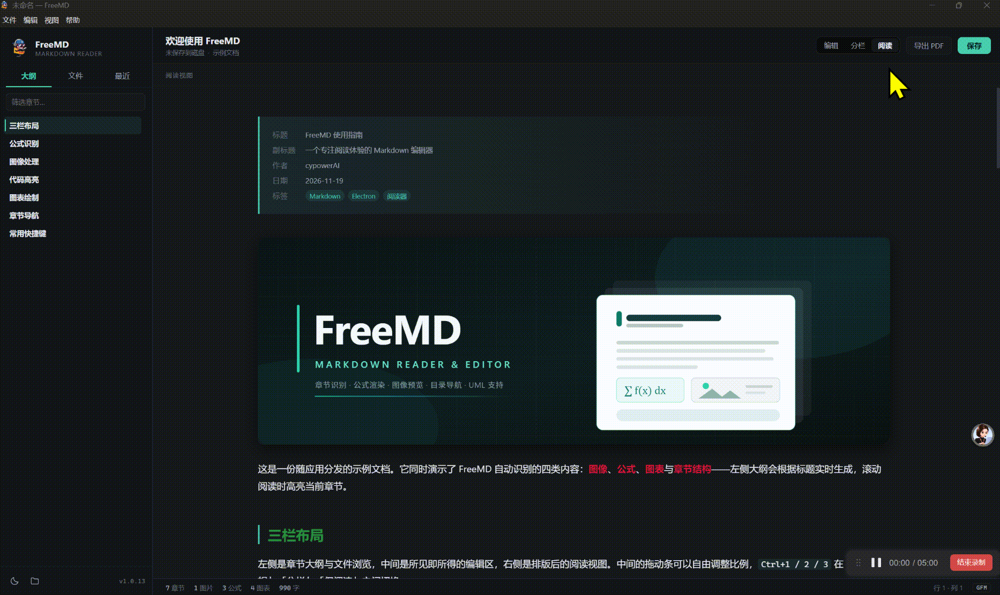

# FreeMD

> 专注阅读体验的 Markdown 阅读器与编辑器。自动识别文档中的**图像**、**公式**、**图表**与**章节结构**，并据此生成可点击、可联动的目录导航。

FreeMD 是一个基于 Electron 的桌面应用：左栏是章节大纲与文件浏览，中间是编辑区，右侧是排版后的阅读视图。它把「读」和「写」放在同一个窗口里，滚动位置双向同步。



---

## 下载安装

从 [Releases](https://github.com/cypowerAI/FreeMD/releases/latest) 页面下载对应平台的安装包（当前版本 **1.0.13**：侧栏更换产品形象 Logo，默认深色主题与阅读视图，欢迎页补充 UML 特性说明）：

| 平台 | 文件 | 类型 |
| --- | --- | --- |
| Windows | `FreeMD-1.0.13-win-x64.exe` | NSIS 安装程序（可选安装目录、创建桌面快捷方式） |
| Windows | `FreeMD-1.0.13-portable-x64.exe` | 免安装绿色版，双击即用 |
| Linux (x64) | `FreeMD-1.0.13-linux-x64.deb` | Debian / Ubuntu 安装包，`sudo apt install ./FreeMD-1.0.13-linux-x64.deb` |
| Linux (x64) | `FreeMD-1.0.13-linux-x64.AppImage` | 通用免安装包，下载后 `chmod +x` 直接运行，适用于 Fedora / Arch / 其他发行版 |
| macOS (Intel) | `FreeMD-1.0.13-mac-x64.zip` | 解压后拖入「应用程序」 |
| macOS (Apple Silicon) | `FreeMD-1.0.13-mac-arm64.zip` | 解压后拖入「应用程序」 |

> macOS 版本未做代码签名。首次打开若提示「无法验证开发者」，请在「访达」中右键点击 FreeMD.app → 打开，或执行 `xattr -cr FreeMD.app` 后再启动。
>
> Linux 安装后若缺少系统依赖，可执行 `sudo apt-get install -y libgtk-3-0 libnotify4 libnss3 libxss1 libxtst6 xdg-utils libatspi2.0-0 libsecret-1-0`。安装后也可直接用终端命令 `freemd` 启动。

### Linux 启动报 SUID sandbox 错误？

如果启动时出现：

```
FATAL:setuid_sandbox_host.cc(163)] The SUID sandbox helper binary was found, but is not
configured correctly. Rather than run without sandboxing I'm aborting now. You need to
make sure that /opt/FreeMD/chrome-sandbox is owned by root and has mode 4755.
```

说明安装包里 `/opt/FreeMD/chrome-sandbox` 的权限不是 `root:root` + `4755`。Chromium 的 SUID sandbox helper 必须带 setuid 位；Ubuntu 23.10+/24.04、Debian 12 起默认用 AppArmor 限制非特权 user namespace，因此即使内核支持 user namespace，普通用户启动时仍会走 SUID helper。

当前下载的安装包已修正该权限（打包脚本 `build/linux/after-install.tpl` + `scripts/fix-deb-sandbox.sh`）。**已经安装过旧包的用户**可以执行下面一条命令原地修复，或重新下载安装包覆盖安装：

```bash
sudo chown root:root /opt/FreeMD/chrome-sandbox && sudo chmod 4755 /opt/FreeMD/chrome-sandbox
```

`freemd --no-sandbox` 也能启动，但会关掉 Chromium 的沙箱隔离，仅建议临时验证使用。

---

## 核心能力

### 自动识别

| 识别对象 | 行为 |
| --- | --- |
| **章节结构** | 解析 `#` ~ `######` 标题层级，按 Markdown 原生级别生成大纲树（不自动追加编号）；对没有 Markdown 标题的纯文本笔记，用「第一章」「1. 概述」等行文特征做启发式识别并标注徽标 |
| **公式** | `$...$` 行内公式与 `$$...$$` 块级公式由 KaTeX 渲染，支持矩阵、积分、多行推导 |
| **图表** | 以 `mermaid` 作为代码块语言标记时由 Mermaid 渲染为 SVG：流程图、时序图、类图（UML）、状态图、ER 图、甘特图、饼图等；`plantuml` / `puml` 的 PlantUML 类图在本地转写后同样渲染（无需 Java）；配色随主题变化，语法错误时退回显示源码 |
| **图像** | 相对路径按文档所在目录解析（`assets/x.png`、`../img/a.jpg` 均可），支持绝对路径、网络图片、`data:` 内联图 |
| **元信息** | 解析 YAML front matter 的 title / author / date / tags，渲染成文档信息卡 |
| **任务列表** | `- [ ]` / `- [x]` 渲染为带勾选状态的条目 |

### 阅读与导航

- 大纲点击定位、正文滚动高亮当前章节（scroll-spy）
- 编辑区与阅读区滚动位置双向同步
- 图片点击放大（滚轮缩放），代码块一键复制
- 文档内查找（`Ctrl+F`），命中项高亮并可上/下跳转
- 深色 / 浅色主题，三档视图（仅编辑 / 分栏 / 仅阅读），分栏比例可拖动

### 编辑与文件

- CodeMirror 5 编辑器：GFM 语法着色、行号、括号匹配、自动换行
- 工具栏快捷排版：标题、加粗、斜体、代码、引用、列表、链接、图片、公式
- 拖拽或粘贴图片自动存入文档同级 `assets/` 目录并插入引用
- 打开文件夹后在左侧树中浏览、切换文档
- 保存 / 另存为、未保存修改提醒、最近打开记录
- 一键导出 PDF（A4 排版，公式、图表与代码块保留）
- 关联 `.md` / `.markdown` 文件，支持「打开方式」直接打开

---

## 快捷键

| 快捷键 | 功能 |
| --- | --- |
| `Ctrl/Cmd + N` | 新建文档 |
| `Ctrl/Cmd + O` | 打开文件 |
| `Ctrl/Cmd + Shift + O` | 打开文件夹 |
| `Ctrl/Cmd + S` | 保存 |
| `Ctrl/Cmd + Shift + S` | 另存为 |
| `Ctrl/Cmd + P` | 导出 PDF |
| `Ctrl/Cmd + F` | 文档内查找 |
| `Ctrl/Cmd + 1 / 2 / 3` | 仅编辑 / 分栏 / 仅阅读 |
| `Ctrl/Cmd + Shift + L` | 切换主题 |
| `Ctrl/Cmd + Shift + I` | 开发者工具（开发模式） |

---

## 本地开发

环境要求：Node.js ≥ 18，npm ≥ 9。

```bash
git clone https://github.com/cypowerAI/FreeMD.git
cd FreeMD
npm install      # 安装依赖，并通过 postinstall 复制渲染层静态资源到 src/renderer/vendor
npm start        # 启动应用
npm run dev      # 启动应用并打开开发者工具
```

`src/renderer/vendor/` 存放 markdown-it、KaTeX、highlight.js、CodeMirror、DOMPurify、Mermaid 的运行时文件，由 `scripts/prepare-vendor.js` 从 `node_modules` 复制而来，因此不纳入版本库，应用完全离线运行，不依赖任何 CDN。

## 打包

```bash
# Windows：NSIS 安装包 + 免安装版
npm run pack:win

# Linux：deb 安装包（需在 Linux 上执行）
# 打包后会调用 scripts/fix-deb-sandbox.sh 把 chrome-sandbox 修正为 root:root + 4755（需 sudo）
npm run pack:linux

# macOS：在 Linux / macOS 上生成免签名 zip
node scripts/build-mac-zip.js --arch x64 --arch arm64
```

产物输出到 `release/` 目录。

> macOS 的 dmg / 签名分发需要 Apple 开发者证书并在 macOS 上构建；仓库内提供的 `build-mac-zip.js` 用于在没有 Mac 设备时生成可直接解压运行的 `.app` zip。

---

## 项目结构

```
FreeMD/
├── build/                  # 打包资源（应用图标）
├── scripts/
│   ├── prepare-vendor.js   # 把第三方运行时资源复制到 renderer/vendor
│   └── build-mac-zip.js    # 非 macOS 环境下生成 macOS zip
├── src/
│   ├── main.js             # 主进程：窗口、菜单、对话框、文件系统、PDF 导出
│   ├── preload.js          # contextBridge 白名单桥接
│   └── renderer/
│       ├── index.html      # 界面骨架
│       ├── styles.css      # 双主题样式
│       ├── app.js          # 编辑器、大纲、滚动同步、文件操作、Mermaid 渲染
│       ├── markdown.js     # markdown-it + KaTeX + 章节/图像/图表识别管线
│       ├── print.css       # PDF 导出排版
│       ├── welcome.md      # 内置示例文档
│       └── assets/         # 示例文档配图
└── package.json            # 依赖与 electron-builder 配置
```

## 安全设计

- 渲染层 `nodeIntegration: false`、`contextIsolation: true`、`sandbox: true`
- 主进程能力仅通过 `preload.js` 中显式声明的方法暴露
- 渲染出的 HTML 经 DOMPurify 过滤，`<script>`、事件属性、表单元素一律移除
- 外部链接通过系统浏览器打开，不会在应用内导航
- 未保存修改在关闭窗口、打开新文档前会二次确认

## 许可

[GPL-3.0](LICENSE)
