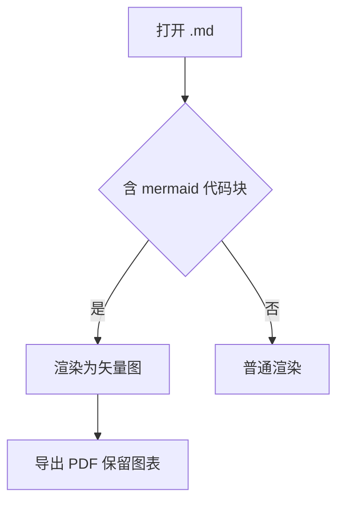

这是一份随应用分发的示例文档。它同时演示了 FreeMD 自动识别的四类内容：**图像**、**公式**、**图表**与**章节结构**——左侧大纲会根据标题实时生成，滚动阅读时高亮当前章节。

## 三栏布局

左侧是章节大纲与文件浏览，中间是所见即所得的编辑区，右侧是排版后的阅读视图。中间的拖动条可以自由调整比例，`Ctrl+1 / 2 / 3` 在「仅编辑」「分栏」「仅阅读」之间切换。

- **仅编辑** —— 适合快速记录，隐藏预览以减少干扰
- **分栏** —— 边写边看，滚动位置双向同步
- **仅阅读** —— 沉浸阅读，图片可点击放大

## 公式识别

行内公式写作 `$E = mc^2$`，渲染为 $E = mc^2$；块级公式用两个美元符号包裹：

$$
\int_{-\infty}^{\infty} e^{-x^2}\,\mathrm{d}x = \sqrt{\pi}
$$

矩阵与多行推导同样支持：

$$
\begin{aligned}
\nabla \cdot \mathbf{E} &= \frac{\rho}{\varepsilon_0} \\
\nabla \times \mathbf{B} &= \mu_0\mathbf{J} + \mu_0\varepsilon_0\frac{\partial \mathbf{E}}{\partial t}
\end{aligned}
$$

## 图像处理

文档中的相对路径会按 Markdown 文件所在目录解析，因此把图片放在文档旁边的 `assets/` 目录即可正常显示，无需任何配置。

| 场景 | 支持情况 |
| :--- | :--- |
| 相对路径 | `assets/photo.png` |
| 绝对路径 | `D:/notes/assets/photo.png` |
| 网络图片 | `https://example.com/a.png` |
| 剪贴板粘贴 | 自动存入文档旁的 `assets/` 并插入链接 |

拖拽图片到编辑区，或直接粘贴截图，FreeMD 会把文件写进文档同级的 `assets/` 目录，并补上引用。

## 代码高亮

```javascript
// 代码块由 highlight.js 着色，右上角可一键复制
function outline(headings) {
  const counters = [0, 0, 0, 0, 0, 0];
  return headings.map((heading) => {
    const level = heading.level;
    counters[level - 1] += 1;
    for (let i = level; i < counters.length; i += 1) counters[i] = 0;
    return counters.slice(0, level).join('.');
  });
}
```

## 图表绘制

用 `mermaid` 作为代码块的语言标记，流程图、时序图、类图、状态图、ER 图、甘特图都会被渲染成矢量图形，配色跟随当前主题，导出 PDF 时同样保留：




语法写错时不会中断渲染流程，图表位置会退回显示原始源码并给出错误提示。

## 章节导航

标题层级会压缩成编号：一级标题为 `1`，其下的二级标题为 `1.1`，依此类推。点击大纲中的任意条目，阅读视图会平滑滚动到对应位置；反过来滚动正文，大纲会同步高亮当前所在的小节。

> 如果一份纯文本笔记没有使用 `#` 标题，而是以「第一章」「1. 概述」这类行文划分结构，FreeMD 也会做一次启发式扫描，把这类行升级为可导航的章节，并在大纲中标注「识别」徽标。

## 常用快捷键

| 快捷键 | 功能 |
| :--- | :--- |
| `Ctrl/Cmd + O` | 打开文件 |
| `Ctrl/Cmd + S` | 保存 |
| `Ctrl/Cmd + Shift + S` | 另存为 |
| `Ctrl/Cmd + F` | 文档内查找 |
| `Ctrl/Cmd + P` | 导出 PDF |
| `Ctrl/Cmd + Shift + L` | 切换深色主题 |

## 下一步

- [x] 打开一份自己的 Markdown 笔记试试
- [ ] 用 `Ctrl+Shift+O` 打开整个文件夹，在左侧树中切换文档
- [ ] 导出 PDF，检查打印排版

祝阅读愉快。
